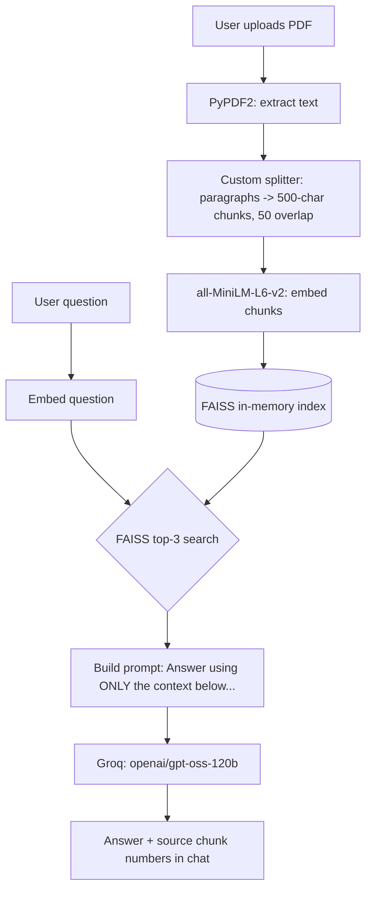
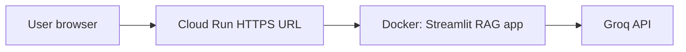

# Document Assistant – RAG Chatbot

A minimal Retrieval-Augmented Generation (RAG) chatbot. Upload a PDF, ask questions, and get answers grounded in the document with chunk-number citations.

**Stack (no LangChain, no LlamaIndex):**

| Layer | Tool |
|---|---|
| UI | Streamlit |
| LLM | Groq API – `openai/gpt-oss-120b` |
| Embeddings | `sentence-transformers` – `all-MiniLM-L6-v2` (local) |
| Vector store | FAISS (in-memory) |
| PDF parsing | PyPDF2 |
| Chunking | Custom: paragraphs, then 500-char chunks with 50-char overlap |

## Architecture



ASCII version:

```
 PDF --> PyPDF2 --> Splitter --> MiniLM embeddings --> FAISS index
                                                          |
 Question --> MiniLM embedding --> top-3 search ----------+
                                        |
                                        v
                      Prompt (context + question) --> Groq GPT-OSS 120B
                                                          |
                                                          v
                                          Answer + cited chunk numbers
```

## Project structure

```
.
├── app.py
├── requirements.txt
├── Dockerfile
├── .dockerignore
├── README.md
└── .streamlit/
    └── config.toml
```

## How to run locally

1. **Clone / copy the project** and open a terminal in its folder.

2. **Create a virtual environment** (Python 3.10–3.12 recommended):

   ```bash
   python -m venv .venv
   source .venv/bin/activate        # Windows: .venv\Scripts\activate
   ```

3. **Install dependencies:**

   ```bash
   pip install -r requirements.txt
   ```

4. **Get a free Groq API key** at <https://console.groq.com/keys>.

5. **Provide the key** using either option:

   - Environment variable:

     ```bash
     export GROQ_API_KEY="gsk_your_key_here"      # Windows PowerShell: $env:GROQ_API_KEY="gsk_your_key_here"
     ```

   - Or a local secrets file `.streamlit/secrets.toml` (do **not** commit it):

     ```toml
     GROQ_API_KEY = "gsk_your_key_here"
     ```

6. **Run the app:**

   ```bash
   streamlit run app.py
   ```

   Open <http://localhost:8501>. The first run downloads the embedding model (~90 MB).

## How to deploy on Streamlit Community Cloud (step by step)

1. **Push the project to GitHub.** Create a new public or private repo and commit `app.py`, `requirements.txt`, `README.md`, and `.streamlit/config.toml`.
   Add a `.gitignore` containing `.streamlit/secrets.toml` and `.venv/` so secrets never get committed.

2. Go to <https://share.streamlit.io> and **sign in with GitHub**.

3. Click **Create app** (or **New app**) and choose **Deploy a public app from GitHub**.

4. Select your **repository**, **branch** (e.g. `main`), and set **Main file path** to `app.py`.

5. Click **Advanced settings**:
   - Choose **Python 3.11** (or 3.10 / 3.12).
   - Paste your secret (see next section) into the **Secrets** box.

6. Click **Deploy**. The first build takes a few minutes because it installs `torch` and `sentence-transformers`. Later restarts are faster.

7. Open the generated `*.streamlit.app` URL, upload a PDF, and start chatting.

## How to add GROQ_API_KEY in Streamlit Cloud secrets

**Before first deploy:** in *Advanced settings → Secrets*, paste:

```toml
GROQ_API_KEY = "gsk_your_key_here"
```

**After deploying:**

1. Open your app dashboard at <https://share.streamlit.io>.
2. Click the **⋮** menu next to your app → **Settings**.
3. Open the **Secrets** tab.
4. Paste the line above (with your real key) and click **Save**.
5. The app restarts automatically and picks up the key.

The app reads the key with `st.secrets["GROQ_API_KEY"]` and falls back to `os.environ["GROQ_API_KEY"]` for local development.

## Traditional cloud: deploy on GCP (Cloud Run + Docker)

This is the **traditional cloud** path for this project: a Docker image hosted on **Google Cloud Run**, API key as a runtime secret, HTTPS URL from GCP. (You need a GCP project with billing enabled.)



### 1. Build and test the image locally (optional)

```bash
docker build -t doc-assistant .
docker run --rm -p 8080:8080 -e GROQ_API_KEY="gsk_your_key_here" doc-assistant
```

Open <http://localhost:8080>. Do **not** bake the key into the image.

### 2. Deploy to Cloud Run

Replace `YOUR_PROJECT_ID` with your GCP project id.

```bash
gcloud config set project YOUR_PROJECT_ID
gcloud services enable run.googleapis.com artifactregistry.googleapis.com cloudbuild.googleapis.com

gcloud run deploy doc-assistant \
  --source . \
  --region asia-south1 \
  --allow-unauthenticated \
  --memory 2Gi \
  --cpu 2 \
  --timeout 300 \
  --set-env-vars GROQ_API_KEY=gsk_your_key_here
```

`--source .` builds the `Dockerfile` in Cloud Build and deploys it. Use **2Gi** memory: `torch` and embeddings will crash a 512Mi instance.

When it finishes, Cloud Run prints a URL like `https://doc-assistant-xxxxx-el.a.run.app`.

### 3. Alternative: Compute Engine VM (closer to a classic VM)

1. GCP Console → **Compute Engine** → **Create instance**.
2. Machine type: **e2-medium** (2 vCPU / 4 GB).
3. Boot disk: 20 GB.
4. Firewall: allow HTTP (or open tcp:8080).
5. SSH in, install Docker, clone the repo, then:

```bash
docker build -t doc-assistant .
docker run -d --name doc-assistant --restart unless-stopped \
  -p 8080:8080 \
  -e GROQ_API_KEY="gsk_your_key_here" \
  doc-assistant
```

Open `http://<VM_EXTERNAL_IP>:8080`.

### 4. How to describe this in a report / viva

> The RAG chatbot is containerized with Docker and deployed on **Google Cloud Run**. Users reach it over HTTPS. Embeddings and FAISS run in the container. The LLM is **Groq** (cloud API). The API key is injected as a Cloud Run environment variable, not stored in Git.

## Notes on `.streamlit/config.toml` and `$PORT`

The config sets `headless = true`. A bare `port = $PORT` line is **not valid TOML** and would make Streamlit fail at startup, so it is intentionally omitted. Streamlit Community Cloud manages the port itself. If you deploy somewhere that injects `$PORT` (Render, Railway, Heroku), run:

```bash
streamlit run app.py --server.port $PORT
```

## Limitations

- Scanned (image-only) PDFs have no extractable text; the app warns you. OCR is not included.
- The FAISS index lives in memory and is rebuilt whenever you upload a different PDF.
- One PDF at a time.
- Each question is answered from the top-3 retrieved chunks only; chat history is displayed but not fed back into the prompt.

## Troubleshooting

| Problem | Fix |
|---|---|
| `GROQ_API_KEY not found` | Add it to secrets or export it as an environment variable. |
| Build is slow or runs out of memory on Cloud | `torch` is large; reboot the app from the dashboard and retry. |
| `faiss` import error locally | Make sure you installed `faiss-cpu`, not `faiss`. |
| Answer says info isn't in the document | Rephrase the question using words that appear in the PDF. |
